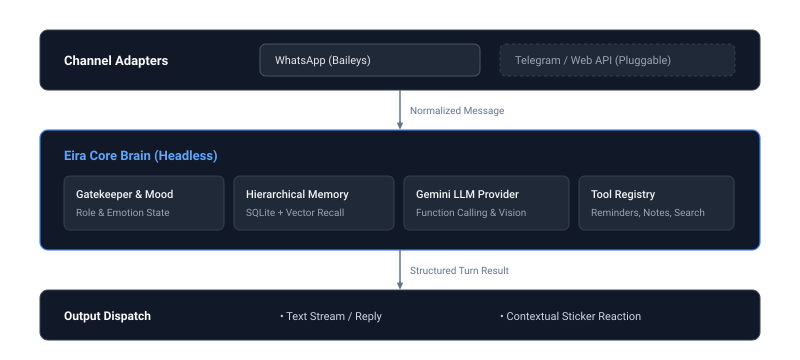

# Eira Yuki (雪エイラ)

A personal, conversational AI companion built with a headless architecture, hierarchical memory, state-based mood tracking, deterministic prefix commands, and tool execution.

> [!NOTE]
> This repository is customized specifically for my personal daily use cases. The repository is open-source and public for transparency, sharing, and showcase purposes. Default parameters (such as the `Asia/Jakarta` timezone, character traits, and bilingual Indonesian/English vernacular) are configured to match my personal environment. The underlying architecture remains fully modular and configurable.

---

## Architecture & Adapter Pattern

Eira Yuki enforces strict decoupling between **Intelligence (Core Brain)** and **Communication (Channel Adapters)**:

1. **Headless Core (`src/core/`)**:
   - Operates as a protocol-agnostic AI agent and command router. The core brain has no knowledge of WhatsApp, Telegram, or any specific messaging network.
   - Accepts normalized input (`IncomingMessage`: text, sender ID/name, role, chat type, optional `media`, `secondaryMedia`, and `quotedMessage`) and returns a standardized response (`CoreResponse`: reply text, web sources, sticker/image attachments, tool actions).
2. **Channel Adapters (`src/adapters/`)**:
   - Act as translation layers between external platforms and the Core Brain.
   - **WhatsApp Adapter (`src/adapters/whatsapp/`)**: Uses `@whiskeysockets/baileys` (with a `patch-package` patch for native `audioStickerMessage` support) to manage connection state, pairing, media downloads, passive `@mention` name resolution (`MentionResolver`), natural multi-bubble pacing (`message-pacer`), and WhatsApp-specific sticker commands (`.sticker`, `.asticker`).
   - **Pluggability**: Additional channels (such as Telegram, Discord, or a local REST/WebSocket IPC client) can be plugged in as new adapter folders and register their own platform commands onto `CommandRouter` without modifying core agent logic.

---

## Architecture Overview



---

## Key Features

1. **Natural Conversational Flow, Vision & WhatsApp Pacing**:
   - Direct conversational turns with multimodal support: text queries and incoming WhatsApp images are analyzed directly by the model.
   - **Natural Multi-Bubble Pacing**: Long or multi-paragraph replies are split into up to 3 natural bubbles using `Intl.Segmenter` based on `bot.locale` with proportional typing delays (`600–1500 ms`), while keeping URLs, lists, and `*References:*` intact.
2. **Dual-Persona, Group Context & Access Control**:
   - **Owner Mode**: Private, unrestricted interaction with clearance to manage reminders and personal lore.
   - **Guest / Group Mode**: Reserved, polite, and privacy-guarded. In groups, Eira responds when mentioned, quoted, called by configured aliases (`eira`/`yuki`), or invoked via a registered prefix command.
   - **Group Speaker Attribution & `@mention` Resolution**: Group prompts and persisted chat history tag speakers (`[Name (role)]: message`), while `MentionResolver` passively caches participant names and resolves `@mention` IDs/LIDs to display names.
3. **Deterministic Prefix Commands & Sticker Maker**:
   - Fast, zero-LLM prefix commands (default prefix `.`, configurable via `bot.commandPrefix`) bypass Gemini, chat history, and mood evaluation:
     - `.help` / `.menu`: Lists available commands.
     - `.sticker` / `.s` *(WhatsApp)*: Converts attached or quoted images, GIFs, or videos into silent 512×512 WebP stickers.
     - `.asticker` / `.as` / `.soundsticker` *(WhatsApp)*: Creates native 1-bubble WhatsApp audio stickers from videos with audio, images/GIFs replying to audio, or a 2-step image/GIF followed by audio/voice note within 60 seconds (with automatic fallback to separate sticker + audio on older clients).
4. **Balanced Tool Distribution & Multi-Step ReAct Loop**:
   - **Shared Tools**: Available to all users (`send_sticker`, `set_reminder`, `cancel_reminder`, `list_reminders`, `remember_fact`, `recall_memory`, `web_search`, `read_url`, `get_current_time`). Memory facts are scoped per user entity.
   - **Autonomous Multi-Step Execution (ReAct)**: Capable of multi-hop reasoning (up to `maxHops: 4` across operational tools configured via `ai.multiHopTools` in `config.yaml`), allowing Eira to perform chained searches, read web pages, evaluate intermediate findings, and refine queries autonomously.
   - **Agentic Reflexion Guard & Action Evaluator**: Employs Google Decisions API (`gemini-decision-1`) via `ActionOmissionEvaluator` and `ReflexionGuard` for zero-token binary verification to intercept tool omission / action hallucinations and force self-corrective tool calling.
   - **Automatic Model Failover**: Falls back from the primary model (`gemini-3.1-flash-lite`) to `fallbackModel` (`gemini-3.5-flash-lite`) on quota or transient provider errors to keep turns resilient.
   - **Parallel Execution**: Multiple independent tool calls in a single turn run concurrently using `Promise.all` with per-tool error isolation.
   - **Search & Deep Reading Provider**: Real-time web search via Tavily with DuckDuckGo fallback (`WebSearchService`), deep page reading via `read_url` (`PageFetcher` with Tavily Extractor, HTML cleaning, and SSRF network guard), plus optional Google Search Grounding.
5. **Numerical State-Based Mood Engine**:
   - Emotional state is tracked numerically (0–100%) across four dimensions: `Energy`, `Composure`, `Affection`, and `Playfulness`.
   - Incorporates diurnal time dynamics when inactive, with dynamic updates evaluated semantically via `SemanticMoodEvaluator` based on conversational sentiment.
6. **Hierarchical Memory with Embeddings**:
   - **Working History**: Configurable multi-turn context (default 30 messages) stored in SQLite for conversational continuity.
   - **Self-Evolving Core Profile Facts**: Persistent knowledge about the Owner, Guests (scoped per `senderId`), and Eira herself (`subject: 'eira'` via `remember_fact` with normalized deduplication).
   - **Episodic Memory**: Summarized past conversations indexed with `gemini-embedding-001` vectors and retrieved via cosine similarity when relevant topics re-emerge.
7. **Autonomous Task Scheduling & Web Watcher**:
   - **Multi-Mode Scheduling**: Supports one-shot alarms (`once`), daily routines at specific target times (`daily` in `Asia/Jakarta`), and periodic intervals (`interval` in minutes) with auto-expiration (`durationDays`).
   - **Zero-LLM Webpage Monitoring**: Periodically polls web pages or APIs (`watch_url`), computing SHA-256 hashes without consuming Gemini tokens. Eira only invokes Gemini to alert the user when a real content delta is detected.
   - **Universal Headless Browser SPA Rendering**: Automatically detects client-rendered Single-Page Applications (SPAs like YouTube Live, React/Vue dashboards) via structural DOM heuristics and renders dynamic DOM via on-demand Headless Chromium (`puppeteer-core`) with automatic 30s idle memory teardown and media asset blocking.
   - **Programmatic Anti-Duplication & Cancellation**: Enforces anti-duplication programmatically in SQLite and enables seamless cancellation via `cancel_reminder` by ID or natural search keyword.
   - **Lightweight Auto-Retention**: Completed and cancelled tasks older than 3 days are purged periodically from SQLite.

---

## Tech Stack

- **Runtime**: Node.js `>=22.0.0` (LTS)
- **Language**: TypeScript 6 (Strict Mode)
- **Primary LLM**: Google Gemini (`gemini-3.1-flash-lite` by default, configurable to `gemini-2.5-flash` / `gemini-2.5-pro`)
- **Decisions & Evaluator LLM**: `gemini-decision-1` via `@google/genai`
- **Headless Browser**: `puppeteer-core` with system Chromium / Google Chrome
- **Embedding Model**: `gemini-embedding-001` via `@google/genai`
- **Media Processing**: `sharp` & `fluent-ffmpeg` (`ffmpeg` for animated WebP & Opus OGG audio stickers)
- **Database**: SQLite 3 via `better-sqlite3` & `drizzle-orm`
- **WhatsApp Adapter**: `@whiskeysockets/baileys` (patched via `patch-package`)
- **Logging**: Structured JSON logging with `pino` & `pino-pretty`

---

## Getting Started

### Prerequisites
- Node.js 22.0.0 or higher
- Google Gemini API Key
- *(Optional)* Tavily API Key for live web search
- *(Optional)* `ffmpeg` installed on the host for animated/audio stickers in local dev (pre-installed in `Dockerfile`)

### Installation

1. **Install Dependencies** *(automatically applies `patches/` via `patch-package`)*:
   ```bash
   npm install
   ```

2. **Configuration**:
   ```bash
   cp config/config.example.yaml config/config.yaml
   cp .env.example .env
   ```
   - Set `GEMINI_API_KEY` in `.env`.
   - Configure owner phone numbers, `commandPrefix`, and model parameters in `config/config.yaml`.

3. **Development Mode (Hot Reload)**:
   ```bash
   npm run dev
   ```

4. **Production Build & Execution**:
   ```bash
   npm run build
   npm start
   ```

5. **Docker Deployment**:
   ```bash
   docker compose up -d --build
   ```

---

## Project Structure

```text
eira-yuki/
├── assets/
│   ├── architecture.svg   # System architecture diagram
│   └── stickers/          # Local sticker library & catalog.json
├── config/
│   ├── config.yaml        # Runtime configuration (models, owners, prefix, memory limits)
│   └── system-instruction.txt # Single source of truth for Eira's persona & language rules
├── patches/               # patch-package patches (@whiskeysockets/baileys audioStickerMessage)
├── src/
│   ├── adapters/          # Channel adapters
│   │   └── whatsapp/      # Baileys client, MessageHandler, MentionResolver, MessagePacer & sticker commands
│   ├── config/            # Zod configuration schemas & loader
│   ├── core/              # Headless Core Brain
│   │   ├── agent/         # EiraAgent, ContextAssembler, ExecutionLoop & ReflexionGuard
│   │   ├── browser/       # BrowserManager, PageFetcher, ChromeLocator, HTMLCleaner & NetworkGuard
│   │   ├── commands/      # CommandRouter, BotCommand & built-in HelpCommand
│   │   ├── evaluator/     # ActionOmissionEvaluator
│   │   ├── gatekeeper/    # PermissionGatekeeper (Owner vs Guest)
│   │   ├── memory/        # MemoryService, MemoryConsolidator & similarity search
│   │   ├── persona/       # PersonaBuilder, MoodService & SemanticMoodEvaluator
│   │   ├── providers/     # Gemini LLM/Decision/Embedding & WebSearch (Tavily/DuckDuckGo)
│   │   ├── scheduler/     # TaskScheduler, TaskService, TaskExecutor & NotificationFormatter
│   │   └── tools/         # ToolRegistry & built-in tools (stickers, search, read_url, reminders, memory, time)
│   ├── database/          # SQLite schema & Drizzle ORM client
│   └── utils/             # Logger, StickerCatalog resolver & StickerMaker (sharp/ffmpeg)
└── tests/                 # 199 unit & integration tests across 25 files (Vitest)
```

---

## Testing

Run the test suite with Vitest:
```bash
npm test
```

---

## License & Intellectual Property

- **Source Code**: Licensed under the [Apache License, Version 2.0](LICENSE).
- **Character Assets & Trademark**: The name **"Eira Yuki"**, persona definitions, prompts, media assets, and visual identity are the proprietary intellectual property of Adli Farizi. Under Section 6 of Apache-2.0, no rights are granted to use the name "Eira Yuki" or character assets for commercial purposes or derivative products without explicit written permission.
